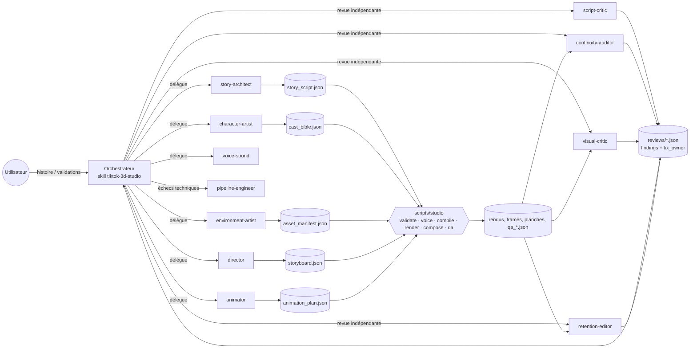

# Architecture technique

## Principes
1. **Données → moteur** : une vidéo = des contrats JSON validés ; le moteur Blender est générique (aucun code
   par épisode). Ajouter une histoire = écrire des données, pas du code.
2. **Déterministe d'abord** : voix, minutage, compilation, rendu, montage, QA, état = `scripts/studio`.
   Les agents ne font que ce qui exige du jugement.
3. **Un artefact = un propriétaire** ; critiques indépendants, en lecture seule, qui regardent des images.
4. **Adressage par contenu** : hash de spec → cache de rendu ; hash d'artefact → validité des validations.
5. **Humain aux décisions créatives majeures** et seul autorisé à déclencher le rendu final ; pas de publication.

## Agents et interactions


## Couches logicielles
```
scripts/studio ─► pipeline/studio/cli.py
  contracts.py   schémas JSON + règles croisées + égalité schémas↔moteur
  state.py       DAG, états, hashes d'entrées, staleness, interruptions, validations liées aux hashes
  tts.py/audio.py synthèse par réplique (cache), timing mot à mot, narration assemblée (horloge)
  compile.py     ancrages (réplique/mot) -> frames ; specs de plans hachées
  render.py      Blender (binaire | module bpy), cache par clé de contenu, reprise par frame, parallélisme borné
  compose.py     clips + transitions, concat, mixage (ducking + loudnorm 2 passes), ASS, MP4
  qa/tech.py     ffprobe + blackdetect/freezedetect/ebur128/silencedetect + synchro
  qa/frames.py   frames horodatées, planches contact légendées
blender/engine/run_shot.py ─► core · characters · animation · sets/kitdata · props · lighting · camera · fx · checks
```

## Arborescence
```
AGENTS.md                      instructions permanentes Codex
.codex/config.toml             config projet (sandbox, approbations, sous-agents, profils)
.codex/agents/*.toml           11 rôles spécialisés
.agents/skills/                tiktok-3d-studio (entrée), visual-review, episode-authoring
references/                    guides chargés à la demande (workflow, capacités moteur, style, grilles…)
references/codex/              schéma officiel config.toml épinglé (audit)
schemas/                       14 schémas JSON (contrats + revue + état)
pipeline/studio/               pipeline déterministe (Python ≥ 3.11)
blender/engine/                moteur de scènes Blender
config/studio.toml, profiles.toml   réglages, limites, profils draft/preview/final
assets/sfx, assets/music       sons générés (originaux) ; assets/library réutilisable ; assets/voices, assets/fonts (vous)
memory/                        mémoire de production (Markdown, recherche ciblée)
episodes/<ep>/                 artefacts, state.json, shots/, audio/, renders/, checks/, lookdev/, reviews/
tests/                         pytest (contrats, état, compile, audio, config Codex, + tests Blender marqués)
scripts/                       install.sh, studio, codex_batch.sh, bootstrap_prompt.md
.studio_cache/ (ignoré)        rendus de plans et clips par clé de contenu
```
