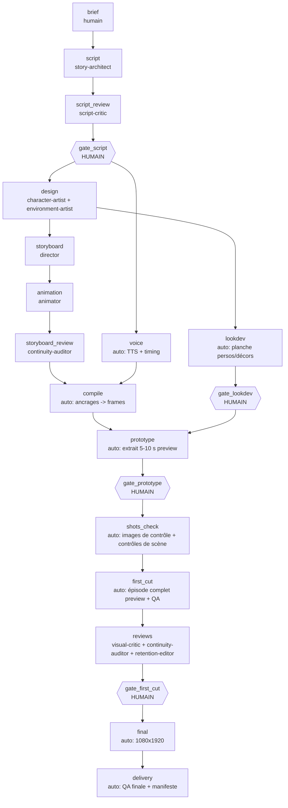

# Workflow de production (DAG, gates, reprise, échecs)

Source de vérité exécutable : `pipeline/studio/state.py` (`STAGES`). Ce document l'explique.

## Graphe des étapes

Parallélisme : `design` ∥ `voice` ; `storyboard` ∥ `lookdev` ; les 3 critiques de `reviews` en parallèle.
Gate 2 (storyboard) = `storyboard_review` (critique, pas d'humain). Gate 5 = `shots_check` (contrôles
automatiques + revue visuelle de la planche). Gates 6/7 = `first_cut` + `reviews`. Gate 8 = corrections
ciblées. Gate 9 = `final` (refusé sans validations humaines valides). Gate 10 = `delivery`.

## Tableau des étapes

| Étape | Entrées | Responsable | Sorties | Bloquant si | Reprise |
|---|---|---|---|---|---|
| brief | histoire | humain (`studio new`) | episode_brief.json | schéma invalide | recréer |
| script | brief | story-architect | story_script.json | `validate` échoue | re-soumettre |
| script_review | script | script-critic | reviews/script-critic_script_rN.json | verdict ≠ approve, blocker | correction → nouvelle revue (max 2) |
| gate_script | script | HUMAIN | approbation liée au hash | — | toute modif du script invalide la validation |
| design | script | character-artist, environment-artist | cast_bible.json, asset_manifest.json | `validate` | re-soumettre |
| voice | script, cast | auto | audio/*, audio_timeline.json | TTS absent | cache par réplique |
| storyboard | script, cast, assets | director | storyboard.json | règles croisées | re-soumettre |
| animation | storyboard | animator | animation_plan.json | règles croisées | re-soumettre |
| storyboard_review | storyboard, animation | continuity-auditor | review | blocker | correction ciblée |
| compile | tout + timeline | auto | shot_manifest.json, shots/*.json | ancrage invalide, timeline obsolète | relancer |
| lookdev | cast, assets | auto | lookdev/contact_sheet.png | rendu en échec | cache |
| prototype | manifest | auto | renders/prototype.mp4 + qa | plan en échec | cache par plan + reprise frame |
| shots_check | manifest | auto | checks/shots_contact.png, scene_checks.json | défaut major (→ needs_review) | cache |
| first_cut | manifest | auto | renders/first_cut.mp4 + qa_first_cut.json | QA bloquante | cache |
| reviews | first cut | 3 critiques | 3 rapports | blocker | corrections ciblées |
| final | 3 validations humaines | auto | renders/final.mp4 + qa_report.json | validation manquante/périmée | cache |
| delivery | final | auto | episode_manifest.json | QA bloquante | relancer |

## États
`pending` → `running` → `completed` | `failed` | `needs_review` ; gates : `approved`.
`stale` : une entrée a changé depuis la complétion (hash) ou une dépendance n'est plus valide.
`interrupted` : l'étape était `running` mais son processus n'existe plus (crash, coupure) → relancer la même
commande : rendu repris à la dernière image écrite, plans terminés servis depuis le cache.

## Stratégies d'échec
- Rendu Blender en échec → `render_manifest_<profil>.json` (erreur) + `.studio_cache/shots/<clé>/blender.log`
  → pipeline-engineer. Le reste de l'épisode n'est pas perdu.
- Revue négative → findings vers `fix_owner` → correction de SON artefact → re-soumission → nouvelle revue
  `_r<N+1>`. Après `quality.max_revision_rounds` tours : `needs_review` + escalade humaine (pas de boucle infinie).
- Défaut systémique (même bug dans ≥ 3 plans) → correction moteur, pas plan par plan.
- Timeline obsolète (script modifié) → `compile` refuse : relancer `voice`.

## Coûts
- Logiciel : 0 € (Blender GPL, FFmpeg LGPL/GPL, espeak-ng GPL, Piper, Python) — vérifier la licence des voix.
- Inférence Codex : consommation de votre offre/API (non mesurée par le pipeline ; à surveiller dans Codex).
- Calcul : local. Mesures réelles en CPU 4 cœurs (Cycles) : draft 360×640 ≈ 1,2 s/image (1 image sur 2 rendue),
  preview 540×960 ≈ 7,5 s/image. Un GPU avec le binaire Blender (EEVEE) est fortement recommandé pour la preview.
- Services externes facultatifs : journaliser chaque dépense (`studio cost`).
